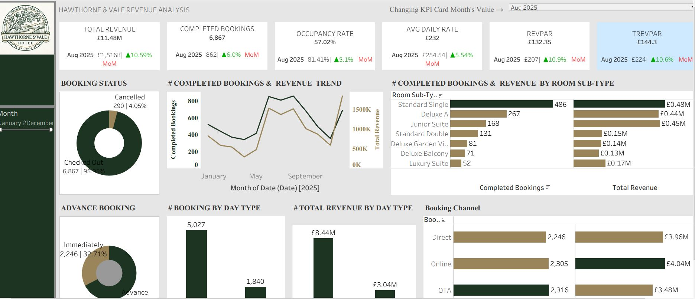

# Hawthorne & Vale Hotel — Hospitality Revenue & Pricing Analysis

A Tableau hospitality analytics project exploring booking demand, revenue, room performance and pricing indicators for Hawthorne & Vale Hotel.

**Tools:** Tableau · Excel source datasets

## Business problem

Hotel managers need to understand how booking demand and revenue vary across the year, which channels bring business and how room categories contribute to performance. These questions help inform pricing, channel management and commercial planning.

This dashboard brings booking outcomes, revenue trends and hotel performance indicators into a single view.

## Project scope

- Compare completed bookings and revenue across months.
- Examine booking outcomes and advance-booking behaviour.
- Compare room sub-types and booking channels.
- Review average daily rate, occupancy, RevPAR and TRevPAR as displayed in the report.
- Use a month selector to compare the selected month's KPI values with the previous month.

## Key findings and business recommendations

- **Completed bookings increased during June–August.** Review room availability and seasonal pricing ahead of periods of stronger demand.
- **Booking channels produced similar volumes but different displayed revenue contributions.** Assess channel performance alongside acquisition costs and commission arrangements before changing the channel mix.
- **The source data contains 6,867 distinct completed bookings and 290 cancellations.** These reconcile to the dashboard's booking-status totals. Further cancellation analysis could help identify patterns by channel and booking lead time.
- **Room categories offer different combinations of volume and revenue.** Use the room comparison to investigate how room mix and rates affect performance, alongside operating costs and availability.

These recommendations identify areas for further investigation and commercial planning.

## Dashboard preview

The report includes headline hotel KPIs, booking-status and advance-booking views, a monthly bookings/revenue trend, room sub-type comparisons and booking-channel analysis.

## Data and documentation

The [source workbook](data/Hotel_Bookings_Data.xlsx) contains all three supplied datasets:

| Worksheet | Contents |
| --- | --- |
| `hotel_bookings_data` | Booking identifiers, dates, room categories, channels, guest segments and status |
| `room_rates` | Room sub-types, base rates and seasonal adjustment factors |
| `ancillary_services` | Dining, spa and event service revenue linked to booking identifiers |

See the [data dictionary](docs/DATA_DICTIONARY.md) for column definitions and the [data notes](docs/DATA_NOTES.md) for source structure and interpretation.

## Repository contents

- [dashboards/](dashboards/) — dashboard screenshot.
- [data/](data/) — the original combined source workbook.
- [docs/](docs/) — data dictionary and source notes.

## Author

**Oluwatobiloba Olufowobi**  
[GitHub](https://github.com/OlufowobiJosh) · [LinkedIn](https://www.linkedin.com/in/olufowobi365/)
